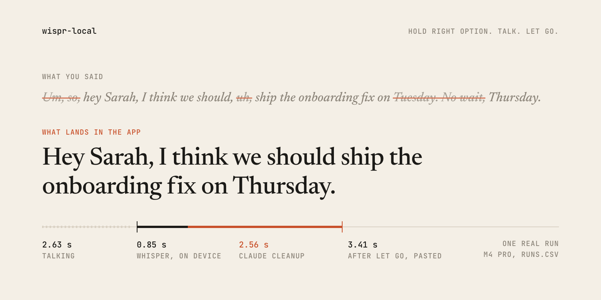

# wispr-local

A free, open-source rebuild of Wispr Flow for macOS: hold right Option, talk, let go, and clean text appears in whatever app you were typing in.

<picture>
  <source media="(prefers-color-scheme: dark)" srcset="docs/hero-dark.png">
  
</picture>

Speech to text runs on your Mac with whisper.cpp. Claude tidies the transcript. The whole app is about 515 lines of Swift.

## Quick start

```sh
git clone https://github.com/eliotb26/wispr-local.git && cd wispr-local
./scripts/setup.sh
swift run -c release wispr-local
```

Setup needs Homebrew. It installs whisper.cpp, downloads the 574 MB speech model into `models/` and builds. Run it from the repo folder, since that's where it looks for the model.

When it prints `ready`, hold right Option and talk. A tink means it's listening, a pop means it stopped. Ctrl+C quits.

The first time, macOS asks your terminal app for Microphone and Accessibility access. Grant both in System Settings > Privacy & Security, then start it again. The first dictation takes about 12 seconds while whisper compiles its GPU shaders. After that it's quick.

Cleanup goes through the [Claude Code](https://claude.com/claude-code) CLI and your existing plan, so there's no API key to set up. Without it, run with `--raw`. For other languages, add `--lang es` or `--lang auto`.

## How it works

When you press the key, it notes the frontmost app and the text already in the focused field, and starts recording.

When you let go, `whisper-cli` transcribes the audio on the GPU.

If you said five words or more, Claude Haiku removes the filler, applies corrections like "Tuesday, no wait, Thursday", and spells names the way they already appear on your screen.

The result goes on the clipboard, ⌘V pastes it, and your own clipboard comes back 500 ms later. The text is marked concealed, so clipboard managers don't keep it.

On an M4 Pro, transcription took 0.8 to 1.2 s across eight real runs. With cleanup on, text landed 3.4 to 4.9 s after letting go, and 2.6 to 3.9 s of that was Claude, mostly CLI startup. The raw numbers are in [docs/runs-m4-pro.csv](docs/runs-m4-pro.csv). Every dictation appends its timings and the app name to `runs.csv`. It never logs what you said.

`Sources/WisprLocalCore` holds the logic that can be tested without a microphone, and its 13 tests. `Sources/wispr-local` is the app itself: hotkey, recorder, whisper and Claude calls, paste.

## Make your own

The app is small enough to reshape, or rebuild from scratch, with Claude Code. Open Claude Code in this folder and ask for the change you want: a different key, a hands-free mode, a local model for cleanup. Or start from nothing with a prompt like this one:

> Build a macOS command-line tool in Swift. While I hold right Option, record the microphone. When I let go, transcribe it locally with whisper.cpp, ask Claude to remove filler words and apply spoken corrections, and paste the result into the focused app. Put my clipboard back afterwards.

## Privacy

Your voice never leaves your Mac. Audio is recorded to a temporary file, transcribed locally and deleted.

With cleanup on, the transcript, the app's name and up to 1,500 characters of the focused field are sent to Claude, so it can match names and tone. With `--raw`, nothing leaves the machine.

## Limitations

- Cleanup is the slow part, because the Claude Code CLI starts fresh on every call. A direct API call or a local model would bring it closer to a second.
- Hold to talk only. There's no hands-free mode, menu bar icon or launch at login.
- It pastes with ⌘V, so fields that block paste won't get the text.
- Permissions are granted to your terminal, not to a standalone app.
- Tested on one machine, an M4 Pro on macOS. Requires macOS 13 or later.

## Development

```sh
swift build -c release
swift test
```

The tests use Swift Testing, which needs full Xcode. If `swift test` can't find it, prefix it with `DEVELOPER_DIR=/Applications/Xcode.app/Contents/Developer`.

## Credits

Transcription is [whisper.cpp](https://github.com/ggml-org/whisper.cpp) by Georgi Gerganov and contributors, running `ggml-large-v3-turbo-q5_0.bin`, a quantized build of OpenAI's Whisper large-v3-turbo. Cleanup is Claude Haiku, called through Claude Code.

## License

MIT. See [LICENSE](LICENSE).

wispr-local is an independent project. It is not affiliated with or endorsed by Wispr, and Wispr Flow is a trademark of its owner.
