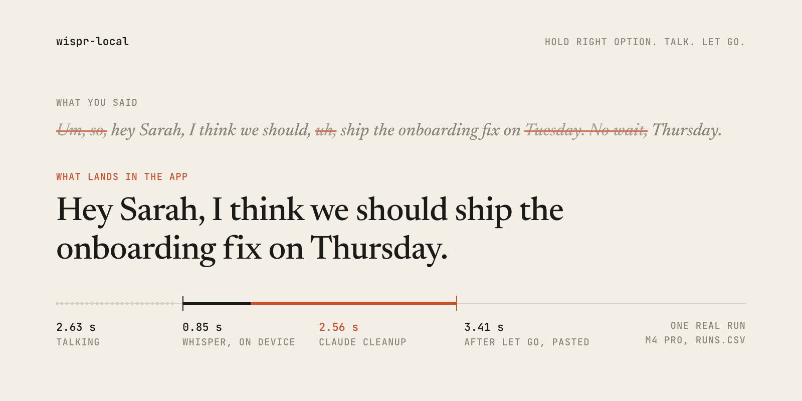

# wispr-local

A free, open-source rebuild of Wispr Flow for macOS: hold right Option, talk, let go, and clean text appears in whatever app you were typing in.

<picture>
  <source media="(prefers-color-scheme: dark)" srcset="docs/hero-dark.png">
  
</picture>

Speech to text runs on your Mac with whisper.cpp. Apple's on-device model tidies the transcript, with Claude as backup. The app is plain Swift.

## Quick start

```sh
git clone https://github.com/eliotb26/wispr-local.git && cd wispr-local
./scripts/setup.sh
swift run -c release wispr-local
```

Setup needs Homebrew. It installs whisper.cpp, downloads the 574 MB speech model into `models/` and builds. Run it from the repo folder, since that's where it looks for the model.

When it prints `ready`, hold right Option and talk. A pop means it stopped listening. Ctrl+C quits.

The first time, macOS asks your terminal app for Microphone and Accessibility access. Grant both in System Settings > Privacy & Security, then start it again. The first launch takes a few seconds to warm up.

### As a Mac app

```sh
./scripts/install-app.sh
```

This builds Chirpkey and puts it in Applications. Open it, allow Microphone and Accessibility, then hold fn and talk. A pill at the bottom of the screen shows your voice level and a live preview of the words. If tapping fn opens the emoji picker, set "Press 🌐 key to" to "Do Nothing" in System Settings > Keyboard.

The built app includes whisper.cpp and downloads its speech models (575 MB) on first launch, so it runs on an Apple silicon Mac without Homebrew. `./scripts/release.sh` makes a notarized DMG.

Opening the app shows its window: Home (totals, streak, rank, next steps), History, Insights, Words, Snippets (a short phrase types a longer text), Style (punctuation and capitals per kind of app) and Scratchpad. Settings opens over it. Its Your voice tab records sentences and adds words that measurably lower your error rate; Connections lets Claude Code, Claude or Cursor search your dictations and notes, read only; Plan and spend shows this month's use. The mic menu has Retry Last Dictation. `scripts/voice-eval.py models/*turbo*.bin` then measures a model on your voice.

Cleanup runs on your Mac with Apple's built-in model (macOS 26 with Apple Intelligence on). Spoken corrections, and edits that changed your words, go to the [Claude Code](https://claude.com/claude-code) CLI if it's installed. In the app this is off until you turn on "Use Claude for hard edits" in Settings. Use `--local` to never call Claude, or `--raw` for no cleanup. For other languages, add `--lang es` or `--lang auto`.

## How it works

When you press the key, it notes the frontmost app and the text already in the focused field, and starts recording.

When you let go, a small local speech detector skips recordings with no speech, since Whisper tends to turn silence into "Thank you." Then a whisper server that stays loaded transcribes the audio on the GPU.

If you said five words or more, Apple's on-device model removes filler and repeats. A check compares every word before and after; if the model added, lost or reordered any, or you corrected yourself out loud ("Tuesday, no wait, Thursday"), Claude Haiku does the edit instead.

The result goes on the clipboard, ⌘V pastes it, and your own clipboard comes back 500 ms later. The text is marked concealed, so clipboard managers don't keep it.

On an M4 Pro, transcription takes about 0.6 s and on-device cleanup about 0.5 s; dictations that go to Claude take 2 to 4 s longer. Earlier runs that used Claude every time are in [docs/runs-m4-pro.csv](docs/runs-m4-pro.csv). Every dictation appends its timings and the app name to `runs.csv`. The timings and the error log never hold what you said. The app's history does: see Privacy.

`Sources/WisprLocalCore` holds the logic that can be tested without a microphone, and its tests. `Sources/wispr-local` is the app itself: hotkey, recorder, pill, whisper, cleanup, paste.

## Make your own

The app is small enough to reshape, or rebuild from scratch, with Claude Code. Open Claude Code in this folder and ask for the change you want: a different key, a hands-free mode, a local model for cleanup. Or start from nothing with a prompt like this one:

> Build a macOS command-line tool in Swift. While I hold right Option, record the microphone. When I let go, transcribe it locally with whisper.cpp, ask Claude to remove filler words and apply spoken corrections, and paste the result into the focused app. Put my clipboard back afterwards.

## Privacy

Your voice never leaves your Mac. Audio is held in memory, briefly written to a temporary file for the speech check, then deleted. The last dictation that typed nothing stays in memory for up to ten minutes so you can retry it.

The app keeps what you dictated for 30 days in `~/Library/Application Support/wispr-local/history.jsonl`, readable only by you. Settings can shorten that, turn it off or delete it. Recordings are kept only if you turn on "Keep recordings". When macOS reports a password field, it isn't read, and what you dictate is not saved or sent to Claude. Some apps don't report theirs, so don't dictate passwords. Voice Test recordings are kept until you delete them, in `~/Library/Application Support/wispr-local/voice-test`.

When Claude does the cleanup, the transcript, the app's name and up to 1,500 characters of the focused field are sent to it. With `--local` or `--raw`, nothing leaves the machine.

## Limitations

- Without Apple Intelligence, cleanup uses Claude every time, which is slower.
- Keeping whisper loaded uses memory while the app is open.
- Hold to talk only. There's no hands-free mode.
- It pastes with ⌘V, so fields that block paste won't get the text.
- When run from a terminal, permissions are granted to the terminal app.
- Tested on one machine, an M4 Pro on macOS. Requires macOS 13 or later.

## Development

```sh
swift build -c release
swift test
```

The tests use Swift Testing, which needs full Xcode. If `swift test` can't find it, prefix it with `DEVELOPER_DIR=/Applications/Xcode.app/Contents/Developer`.

## Credits

Transcription is [whisper.cpp](https://github.com/ggml-org/whisper.cpp) by Georgi Gerganov and contributors, running `ggml-large-v3-turbo-q5_0.bin`, a quantized build of OpenAI's Whisper large-v3-turbo. The window uses the [Geist](https://github.com/vercel/geist-font) typeface (SIL Open Font License). Cleanup is Apple's on-device model, with Claude Haiku through Claude Code as backup.

## License

MIT. See [LICENSE](LICENSE).

wispr-local is an independent project. It is not affiliated with or endorsed by Wispr, and Wispr Flow is a trademark of its owner.
